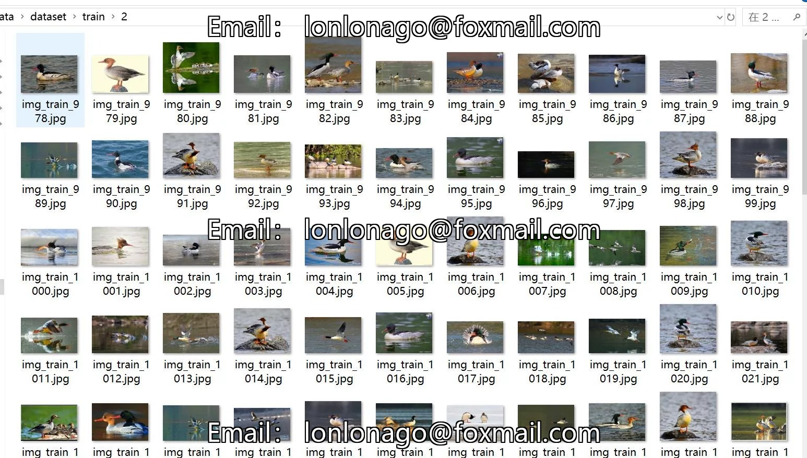
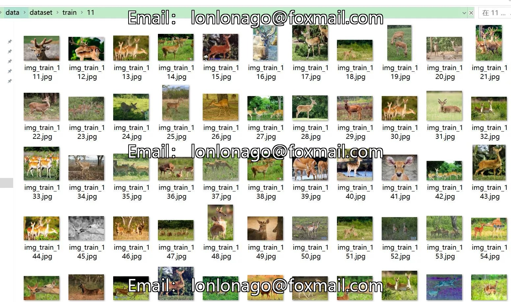
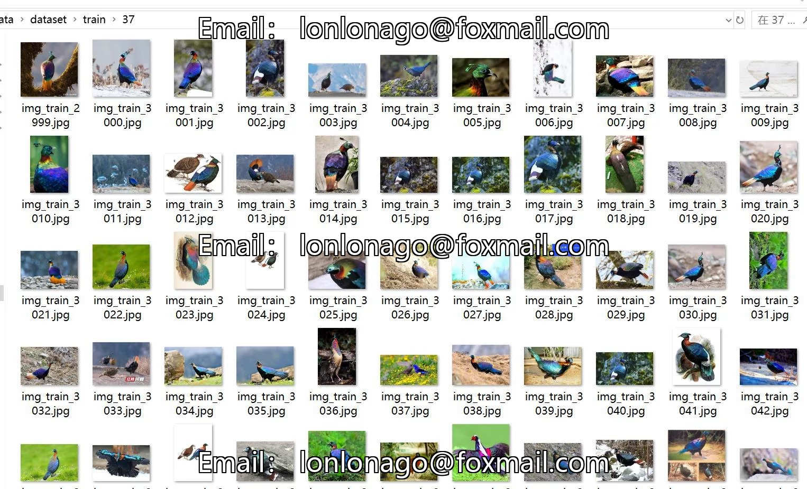

# 67 Category Image Classification Dataset of 67 First-Class Protected Animals with 7894 Images

## Body

67 Species of First-Class Protected Animals Image Classification Dataset: 7894 Images in 67 Categories
Warm Reminder: Due to the dataset's replicability, please confirm compliance with requirements before purchasing.
Dataset Type: For image classification purposes only; not suitable for object detection without labeled files.
Dataset Format: Only contains jpg images, each category folder contains the corresponding images.
Number of Images (Total jpg Files): 7894
Image Resolution: Multi-resolution, such as 1200x878, 500x360, etc.
Number of Categories: 67

1. Chinese white dolphin 2. Chinese autumn sandduck 3. Crane 4. Cloud leopard 5. Asian elephant 6. Manatee 7. Taiwan monkey 8. Taiwan antelope 9. Monkey 10. Four-toed sloth 11. Pobessy 12. Tahr 13. Peacock pheasant 14. Yangtze crocodile 15. Twisted-horned gazelle 16. Common prairie dog 17. Eurasian crested ibis 18. Deer mouse 19. Beaver 20. Gray-bellied sambar 21. Bearded sloth 22. Giant panda 23. Bear 24. White-lipped peccary 25. Spoon-billed sandgrouse 26. Snowy eagle 27. White-necked long-clutched tortoise 28. Crane 29. Sable 30. Red-breasted geese 31. Green peafowl 32. Leopard cat 33. Mongolian wild ass 34. Blue-cheeked hummingbird 35. Tibetan antelope 36. Tiger 37. Plumed pheasanger 38.

1. Honey Monkey 39 Brown-rumped Gull 40 Tibetan Wild Horse 41 Bottlenose Dolphin 42 Deer 43 Leopard 44 Polar Bear 45 Red-throated Eagle 46 Sander's Crane 47 Whooper Swan 48 Wild Bull 49 Wild Yak 50 Wild Camel 51 Golden Langur 52 Golden Leopard 53 Cheetah 54 Giant Panda 55 Snow Leopard 56 Malayan Tiger 57 Bustard 58 Swamp Deer 59 Reed Deer 60 Yellow-bellied Partridge 61 Black-headed Partridge 62 Black-tailed Partridge 63 Black-necked Long-tailed Partridge 64 Black-necked Crane 65 Black-kneeded Goat 66 Eel 67 Small Cervidae

## Images

## Payment

Here is a pay link on Stripe ( https://buy.stripe.com/3cs8yP7sY87d0vu9AB ). Please contact me lonlonago@foxmail.com after funding $89, and I will send you a complete data files , thank you!

